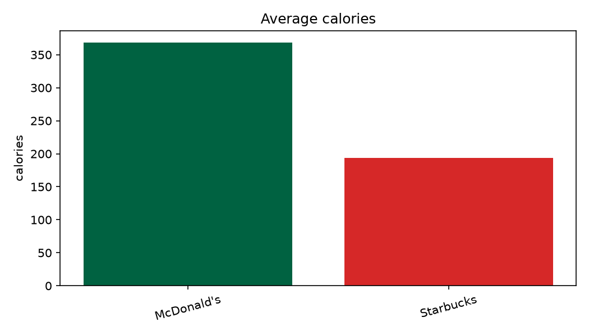
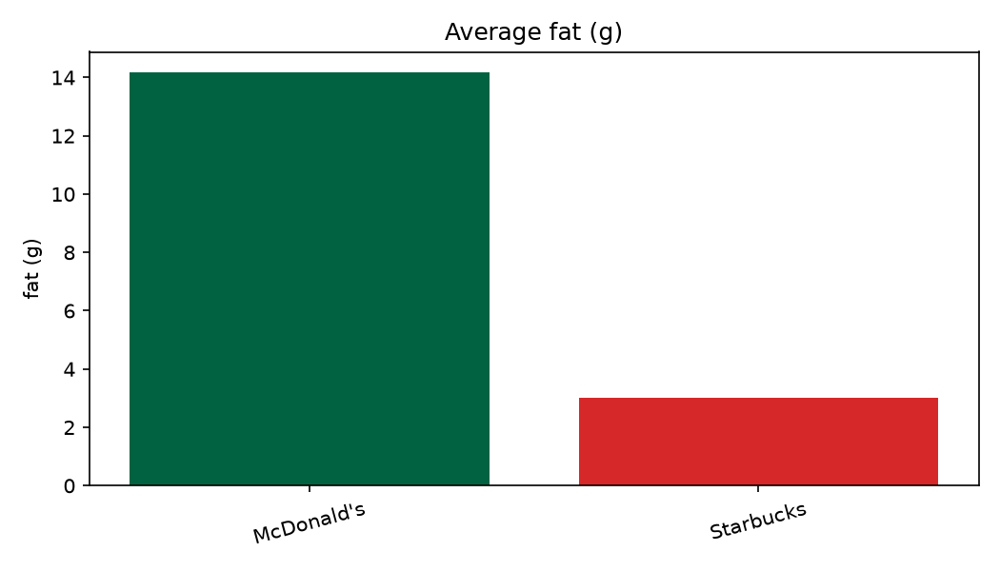
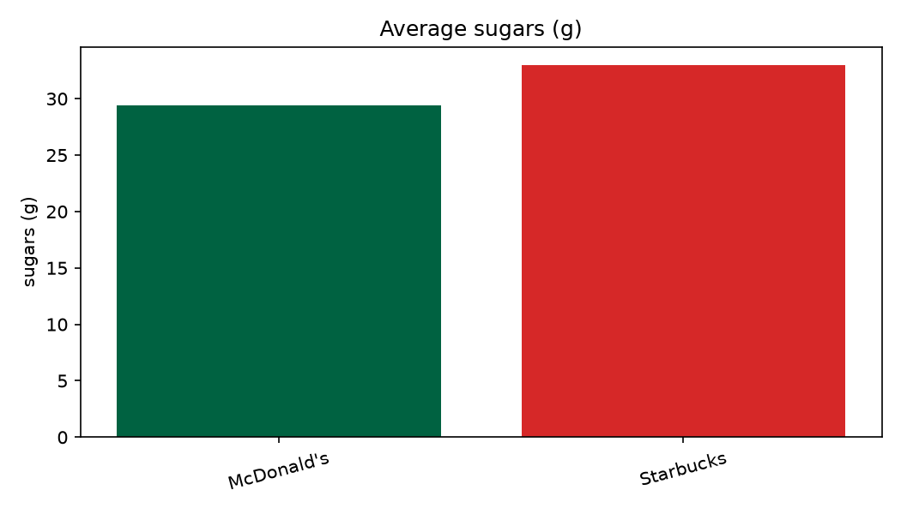
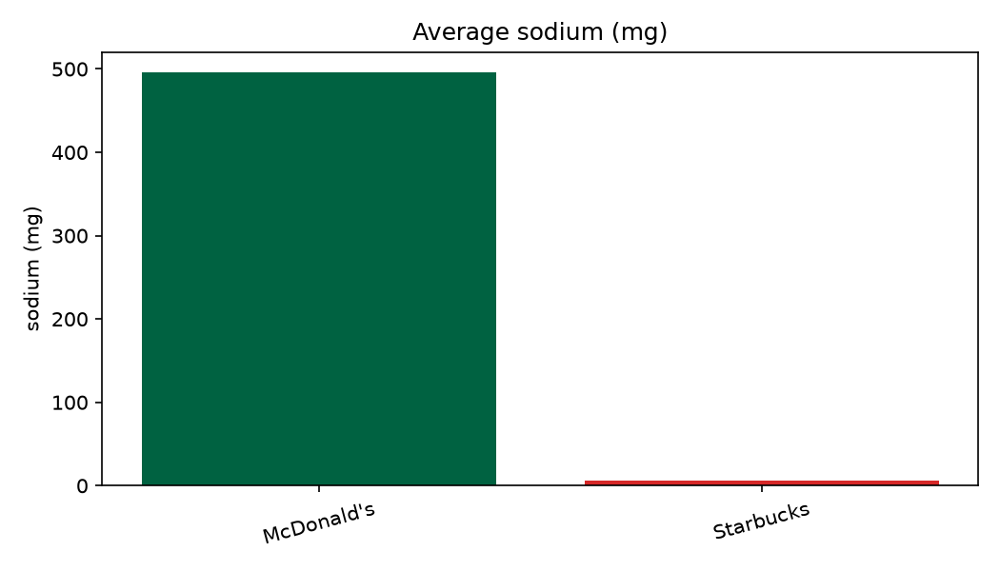
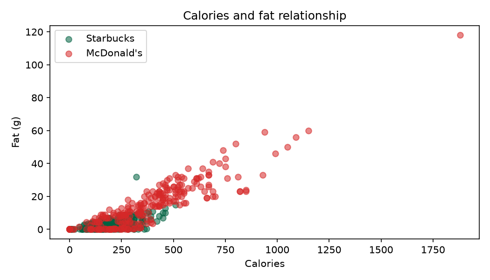

# Starbucks vs McDonald's Nutrition Analysis

## Executive summary

This analysis standardizes nutrition fields from Starbucks drinks and the McDonald's menu
and compares their descriptive nutrition profiles. McDonald's items have higher average
calories, fat, and sodium in this sample, while Starbucks drinks have slightly higher
average sugars. These results should not be interpreted as causal or like-for-like product
comparisons because the source menus represent different product types and serving formats.

## Methodology

CSV files were loaded with PySpark, mapped to a shared schema, and numeric fields were
explicitly converted to doubles. Dashes and non-numeric markers were treated as missing.
All averages, medians, ranges, correlations, and category summaries were calculated from
the standardized Spark dataset; only small result tables were converted to pandas for export
and visualization.

## Scope

This report compares the expanded Starbucks drinks dataset with the McDonald's menu dataset.
The source datasets contain different product types and serving conventions, so results are
descriptive averages rather than like-for-like product comparisons.

## Dataset coverage

- Starbucks items analyzed: 242
- McDonald's items analyzed: 260
- Numeric values shown are averages across available, non-missing values.

## Restaurant summary

```text
restaurant  items  avg_calories  avg_fat_g  avg_carbs_g  avg_protein_g  avg_sodium_mg  avg_sugars_g
McDonald's    260        368.27      14.17        47.35          13.34         495.75         29.42
 Starbucks    242        193.87       3.02       128.88           6.98           6.36         32.96
```

## Descriptive statistics

```text
restaurant    metric  count   mean  median  stddev  min    max
 Starbucks  calories    242 193.87   180.0  102.86  0.0  510.0
 Starbucks     fat_g    242   3.02     2.5    3.49  0.0   32.0
 Starbucks   carbs_g    242 128.88   125.0   82.30  0.0  340.0
 Starbucks protein_g    242   6.98     6.0    4.87  0.0   20.0
 Starbucks sodium_mg    242   6.36     5.0    8.63  0.0   40.0
 Starbucks  sugars_g    242  32.96    32.0   19.73  0.0   84.0
McDonald's  calories    260 368.27   340.0  240.27  0.0 1880.0
McDonald's     fat_g    260  14.17    11.0   14.21  0.0  118.0
McDonald's   carbs_g    260  47.35    44.0   28.25  0.0  141.0
McDonald's protein_g    260  13.34    12.0   11.43  0.0   87.0
McDonald's sodium_mg    260 495.75   190.0  577.03  0.0 3600.0
McDonald's  sugars_g    260  29.42    17.0   28.68  0.0  128.0
```

## Data quality checks

```text
restaurant  rows  duplicate_rows  null_values
 Starbucks   242               0            0
McDonald's   260               0            0
```

## Relationship analysis

Pearson correlation describes linear association only; it does not establish causation.

```text
restaurant          relationship  pearson_correlation
 Starbucks     calories vs fat_g                0.576
 Starbucks   calories vs carbs_g                0.795
 Starbucks calories vs protein_g                0.578
 Starbucks calories vs sodium_mg                0.388
 Starbucks  calories vs sugars_g                0.910
McDonald's     calories vs fat_g                0.904
McDonald's   calories vs carbs_g                0.782
McDonald's calories vs protein_g                0.788
McDonald's calories vs sodium_mg                0.712
McDonald's  calories vs sugars_g                0.260
```

## Charts











## Key findings

- McDonald's has the higher average calories (368.27), while Starbucks is lower (193.87).
- McDonald's has the higher average fat (14.17), while Starbucks is lower (3.02).
- Starbucks has the higher average sugars (32.96), while McDonald's is lower (29.42).
- McDonald's has the higher average sodium (495.75), while Starbucks is lower (6.36).

## Outputs

- [Restaurant summary](../output/restaurant_summary.csv)
- [Category summary](../output/category_summary.csv)
- [Descriptive statistics](../output/descriptive_statistics.csv)
- [Relationship summary](../output/relationship_summary.csv)
- [Standardized item data](../dataset/processed/standardized_nutrition.csv)

## Challenges and resolutions

- The supplied files used different column names and structures; a shared Spark schema was created.
- Starbucks data contained dash markers and mixed numeric/string fields; these were converted to numeric values with invalid markers becoming null.
- On Windows, Spark initially selected the wrong Python worker. The application now pins Spark workers to the active Python interpreter.

## Limitations

- The sample is a menu snapshot and may not represent every current product or serving configuration.
- Starbucks drinks and the McDonald's menu are not matched by equivalent product or serving size.
- Missing nutrient values are excluded from metric-specific averages.
- Descriptive statistics and correlations show association in this dataset and cannot establish causation.
